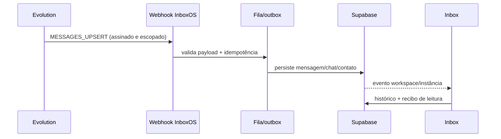

# Auditoria de depuração — InboxOS Fase 16

Data: 13/10/2026  
Ambiente: local `http://127.0.0.1:4173`, com `.env` de staging Supabase  
Método: Playwright autenticado com a sessão de QA `ackleynicolas@gmail.com`, auditoria de rede e testes de contrato. Nenhuma mensagem foi enviada, nenhum grupo foi contatado e nenhum webhook real foi escrito.

## Resultado verificado

- Auditoria pública: **8/8 rotas PASS**, 0 respostas HTTP `>=400`, 0 erros de console e 0 `pageerror` em 390×844.
- Auditoria autenticada: **11/11 fluxos PASS** — tema, barra lateral, CRM, Follow-up, Agentes, modal de Conexões, Clientes (criar/importar/exportar), Calendário, Inbox e Configurações.
- A auditoria autenticada registrou **301 requisições**. Não houve 4xx/5xx nem erro de runtime; houve 26 avisos de latência acima de 1,5 s, com pico local de 3,4 s.
- Endpoint autenticado: `/api/health`, `/api/admin/me`, `/api/workspaces`, `/api/instances`, `/api/chats`, `/api/events`, `/api/agents`, `/api/calendar`, `/api/clients` e `/api/follow-up` responderam 200.
- `npm test`: **339/339 PASS**.
- `tsc --noEmit`: **PASS**.
- `npm run lint`: **0 erros**, 6 avisos antigos de Fast Refresh.
- `npm run audit:release`: **PASS**, 286 arquivos analisados e 88 rotas representadas.
- `npm run audit:env`: **PASS**.
- `npm run build`: **PASS** (Vite + TanStack Start + Nitro/Vercel).

Artefatos: [`tests/e2e-artifacts/audit-summary-interactive.json`](../tests/e2e-artifacts/audit-summary-interactive.json), [`tests/e2e-artifacts/audit-network-interactive.json`](../tests/e2e-artifacts/audit-network-interactive.json) e [`tests/e2e-artifacts/functional-audit-2026-10-13/public-audit.json`](../tests/e2e-artifacts/functional-audit-2026-10-13/public-audit.json).

## Fluxo de dados esperado

```mermaid
flowchart LR
  B[Browser / Playwright] --> A[Auth + workspace ativo]
  A --> R[TanStack Start / API routes]
  R --> D[(Supabase: dados e Realtime)]
  R --> E[Evolution API]
  E --> W[/api/public/webhooks/evolution]
  W --> Q[Inbox de eventos / worker durável]
  Q --> D
  D --> S[/api/events + Realtime]
  S --> B
```

### Entrada de uma mensagem



## Inventário real por página

### Dashboard

Carregou no shell autenticado e preservou navegação, tema e workspace. As métricas são fornecidas por `/api/dashboard`; o contrato de erro é exibido na própria tela. Não houve erro reproduzido.

### CRM

Criar lead, mover estágio e excluir um lead QA passaram via `POST/PATCH/DELETE /api/crm`. O servidor escolhe a etapa inicial do workspace e mantém as relações escopadas. Não foram alterados leads reais.

### Clientes

Os três fluxos solicitados foram exercitados em Playwright:

1. **Criar cliente**: abre o cadastro, valida nome e envia lead manual.
2. **Importar clientes**: lê CSV com nome, telefone e e-mail, ignora a linha de cabeçalho e cria os registros como `source: import`.
3. **Exportar clientes**: gera CSV UTF-8 com nome, telefone, e-mail, empresa e categoria.

Os dois registros QA foram removidos ao final. O endpoint `/api/clients` também passou a funcionar em schema antigo sem `whatsapp_contacts.is_saved`, usando fallback somente para o erro Postgres `42703`; a migration continua necessária para a coluna oficial.

### Inbox

A tela de conversas abriu sem erro. O contrato cobre busca, filtros, eventos, histórico, presença, recibos, mídia e sincronização de fotos. O teste não enviou texto, áudio, mídia nem mensagem para contato real. Realtime remoto e mídia real continuam dependentes de uma instância vinculada ao workspace correto.

### Follow-up

Criar, concluir e excluir tarefa QA passaram. O contexto é lido pelos agentes somente dentro do workspace autenticado e com limite de histórico.

### Calendário

A página abriu, com seleção de dia, capacidade, calendário, cliente e agente. Os endpoints `/api/calendar` e `/api/calendar/appointments` permanecem protegidos por workspace, disponibilidade, sobreposição e capacidade diária. Não foi criado agendamento persistente fora do teste.

### Conexões

O modal de nova conexão abriu, fechou com Escape, prendeu Tab e devolveu o foco ao botão de origem. Não foi gerado QR nem criada instância real.

### Agentes

Criar, alternar estado e excluir agente QA passaram. Objetivo, instruções, handoff, Follow-up e contexto de calendário são persistidos apenas quando autorizados. Não foi chamada a quota Groq.

### Configurações e ADM global

As telas carregaram autenticadas. Perfil, workspace, segurança, documentos legais, integrações e visão administrativa foram lidos; operações destrutivas, rotação de segredos, OTP e newsletter não foram disparadas.

## Correções aplicadas nesta depuração

- Compatibilidade de `whatsapp_contacts.is_saved` em [`crm-contact-sync.server.ts`](../src/server/product/crm-contact-sync.server.ts), sem mascarar outros erros de banco.
- Modal de nova conexão com Escape, trap de Tab e restauração de foco em [`ConnectionManager.tsx`](../src/features/instances/components/ConnectionManager.tsx).
- Seletor de país sem emoji corrompido, com código/DDI/nome legíveis e largura adequada no mobile em [`register.tsx`](../src/routes/auth/register.tsx) e [`styles.css`](../src/styles.css).
- Clientes agora possuem criar, importar CSV e exportar CSV em [`ProductViews.tsx`](../src/features/inbox/components/ProductViews.tsx).
- Importação CSV ignora cabeçalho e não gera `POST /api/crm` inválido.
- Instrumentação Playwright mede latência antes de consumir o corpo da resposta, eliminando falso alerta de dezenas de segundos.

## Achados que não devem ser confundidos com falha de código

1. A linha de sincronização Evolution respondeu 200 com `Nenhuma conexão aberta`: o workspace de staging não possui `WhatsApp_1665` vinculado, embora o provedor tenha essa instância aberta. Não é seguro anexá-la automaticamente, pois isso misturaria tenant/callback de staging e produção.
2. O registro gerenciado de Evolution em staging foi atualizado do host antigo para `https://evolutionapi.vpsautomation.online`. A configuração equivalente da produção/Vercel ainda precisa ser conferida pelo responsável do deploy.
3. As latências de 1,5–3,4 s aparecem sobretudo em cold start/Supabase e chamadas de bootstrap (`workspaces`, `instances`, `crm`, `chats`, `sync`, `clients`). São avisos de performance, não respostas erradas. Devem ser medidas novamente no Preview/produção antes de otimizar queries.
4. Foram encontrados e removidos somente seis resíduos QA antigos com marcador explícito `E2E` (um agente e cinco tarefas). Nenhum cliente, conversa ou registro sem marcador de teste foi alterado.

## Limites e próximos gates

- Não foi possível declarar recebimento realtime real, presença, fotos, áudio, GIF, figurinha, vídeo ou documento da instância WhatsApp sem uma instância explicitamente registrada no workspace de staging.
- Não foi enviado texto de calibração para contato aleatório e não foi usado grupo.
- Antes do deploy final, aplicar/verificar a migration de staging/produção, conferir a URL e o token gerenciado do webhook, registrar a instância correta no workspace e repetir o smoke autenticado.
- O deploy Vercel não foi alterado por esta auditoria.
